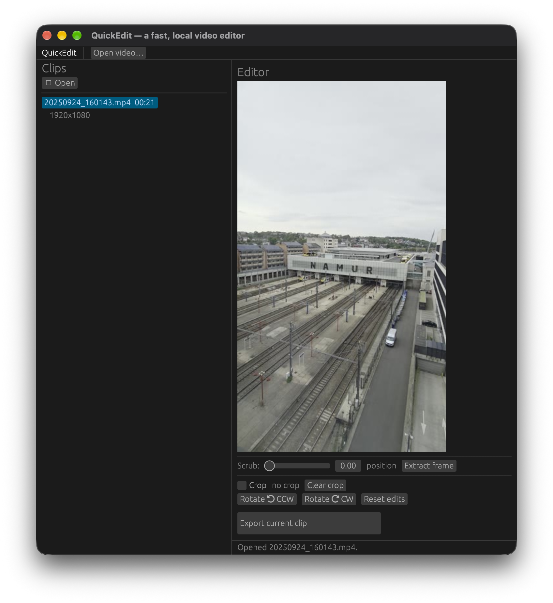

# QuickEdit — a fast, local video editor

**QuickEdit** is a small, cross-platform **desktop video editor** written in pure
Rust. Open a folder, browse every video as a thumbnail grid, pick a clip, and
apply two simple non-destructive edits:

- **Rotate** 90° clockwise or counter-clockwise
- **Crop** by dragging a rectangle on the live preview

Edits are previewed immediately. When you export, the clip is re-encoded with
FFmpeg and written to a new `<name>_edited.mp4` next to the original (the source
file is left untouched, so the operation is always reversible).


<!-- Drop a screenshot at docs/screenshot.png to render it here. -->

---

## Features

- Native, immediate-mode GUI via **egui / eframe** — no web view, no Electron.
- **Thumbnail grid** of every supported video in the chosen folder.
- **Live preview** with a scrub bar to jump to any frame.
- **Rotate CW / CCW** and **drag-to-crop** with a visual overlay.
- **Export** to a new file with the audio stream copied losslessly.
- Detects missing FFmpeg on startup and shows a clear, actionable warning.
- Background threads for export keep the UI responsive.

Supported video extensions: `.mp4`, `.mov`, `.avi`, `.mkv`, `.webm`, `.m4v`,
`.ts` (and anything else FFmpeg can read).

---

## Prerequisites

You need two things: the **Rust toolchain** (to build from source) and
**FFmpeg** (a *runtime* dependency — QuickEdit shells out to the `ffmpeg` and
`ffprobe` executables).

### 1. Rust (stable)

Install from <https://rustup.rs>, or with your package manager:

| Platform | Command |
|----------|---------|
| **Linux** | `curl --proto '=https' --tlsv1.2 -sSf https://sh.rustup.rs \| sh` |
| **macOS** | `curl --proto '=https' --tlsv1.2 -sSf https://sh.rustup.rs \| sh` or `brew install rust` |
| **Windows** | download the installer at <https://rustup.rs> (or `winget install Rustlang.Rustup`) |

### 2. FFmpeg + FFprobe

| Platform | Install |
|----------|---------|
| **Linux (Debian/Ubuntu)** | `sudo apt-get install ffmpeg` |
| **Linux (Fedora)** | `sudo dnf install ffmpeg` |
| **Linux (Arch)** | `sudo pacman -S ffmpeg` |
| **macOS** | `brew install ffmpeg` |
| **Windows** | <https://www.gyan.dev/ffmpeg/builds/> (add the `bin` folder to `PATH`), or `winget install Gyan.FFmpeg` |

Verify the install:

```bash
ffmpeg -version
ffprobe -version
```

> **On Linux you also need egui's system libraries at *build* time**
> (GTK / X11 / ALSA): e.g. `sudo apt-get install libgtk-3-dev libasound2-dev
> libxkbcommon-dev`.

---

## Build from source

QuickEdit ships a small build script per platform. Each one runs
`cargo build --release` and copies the resulting binary into `builds/` with a
platform+arch-stamped name.

### macOS / Linux — `build.sh`

```bash
./build.sh
# → builds/quickedit-<os>-<arch>, e.g. builds/quickedit-darwin-arm64
```

Or do it by hand:

```bash
cargo build --release
# binary: target/release/quickedit  (macOS & Linux)
```

### Windows — `build.ps1` (PowerShell) or `build.bat` (cmd)

```powershell
# PowerShell
.\build.ps1
# → builds\quickedit-windows-x64.exe
```

```bat
REM Command Prompt
build.bat
REM → builds\quickedit-windows-x64.exe
```

Or by hand:

```bat
cargo build --release
REM binary: target\release\quickedit.exe
```

### All three platforms at once (GitHub Actions)

`.github/workflows/build.yml` builds release binaries for **Linux**, **macOS
(Intel + Apple Silicon)** and **Windows** on every push to `main` and uploads
them as artifacts. Open the **Actions** tab on GitHub and run **build → Run
workflow**, then download the artifacts — no local compiler needed.
---

## Run

```bash
# macOS / Linux
./target/release/quickedit            # or ./builds/quickedit-darwin-arm64

# Windows
target\release\quickedit.exe
```

(On macOS, an unsigned binary built locally may be blocked by Gatekeeper once;
right-click → **Open**, or `xattr -d com.apple.quarantine <binary>`.)

---

## Usage

1. **Open a video** — click *Open video…* (or *＋ Open* in the clip list).
2. **Select a clip** in the left panel — its preview loads on the right.
3. **Edit** — *Rotate ⟲/⟳ CW/CCW*, enable *Crop* and drag a rectangle on the
   preview, or use *Scrub* + *Extract frame* to inspect a specific moment.
4. **Export** — *Export current clip* writes `<name>_edited.mp4` next to the
   source (audio preserved, H.264/`yuv420p` for maximum compatibility).

The status bar shows the current operation, any errors (with the offending file
path when relevant), and the number of unsaved edits.

---

## Project layout

```
src/
├── main.rs       eframe entry point
├── ui.rs         egui panels, layout, interactions, threading
├── video.rs      clip model + project (ordered list, selection)
├── ffmpeg.rs     ffmpeg/ffprobe command wrappers + crop-math
├── edit_state.rs rotation + crop model (display-space)
└── error.rs      typed AppError
build.sh              build script (Linux & macOS)
build.ps1 / build.bat build script (Windows)
.github/workflows/build.yml   CI: 3-OS release builds
```

---

## Build artifacts

The following binaries are produced by the build scripts / CI. The macOS
Apple-Silicon binary in `builds/` is included in this repo; the others must be
produced on their own platform (or via GitHub Actions).

| Platform | File | Status |
|----------|------|--------|
| macOS (Apple Silicon) | [`builds/quickedit-darwin-arm64`](builds/quickedit-darwin-arm64) | **produced** ✅ |
| macOS (Intel) | `builds/quickedit-darwin-x86_64` | run `./build.sh` on Intel macOS |
| Linux (x86_64) | `builds/quickedit-linux-x86_64` | run `./build.sh` on Linux |
| Windows (x64) | `builds/quickedit-windows-x64.exe` | run `build.ps1` on Windows |

---

## Known limitations

- **Re-encoding**: exports always re-encode video to H.264 (`crf 18`, a
  visually-lossless setting); audio is copied losslessly when possible.
- **No real-time playback** — preview is a single extracted frame you scrub
  through; this is a trim/rotate/crop tool, not a timeline editor.
- **FFmpeg dependency** — `ffmpeg`/`ffprobe` must be installed and on `PATH`
  (a clear in-app warning appears if they're missing).
- **One output per clip** — export writes `<name>_edited.mp4`; re-exporting
  overwrites that file.
- **Crop is display-space** and is cleared whenever rotation changes, since the
  pixel mapping changes.

---

## License

MIT — see [LICENSE](LICENSE).
